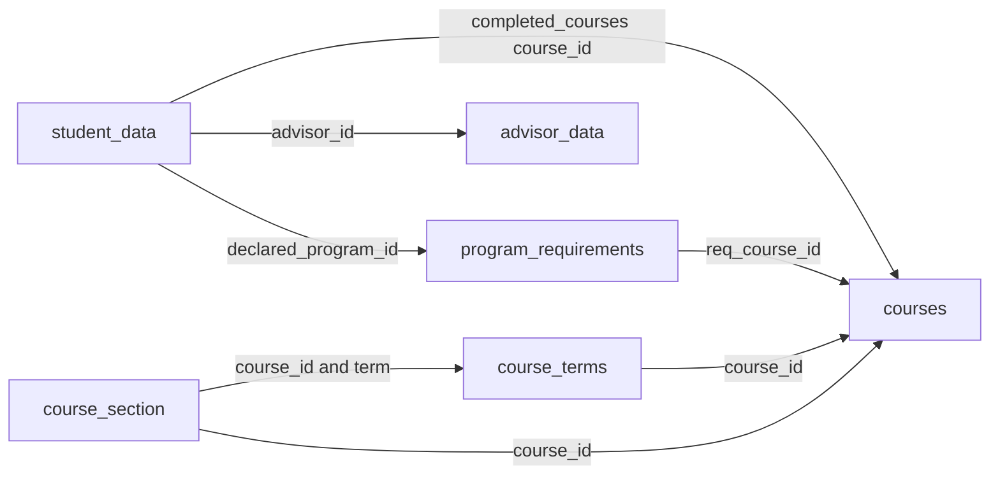

# Original dataset schema

The six CSVs are UTF-8 with headers. IDs and term codes are strings. Structured
JSON is embedded inside several CSV fields and must be decoded after CSV parsing.
Numbers can be missing; a zero-unit course is different from a missing unit value.
The recommendation backend reads these files through `recommender.catalog.Catalog`.
The original scheduler retains its own `DataRepository`.

| File | Grain and key | Rows | Role |
| --- | --- | ---: | --- |
| `courses.csv` | One course per `course_id` | 187 | Canonical course titles, types, content, units, and prerequisites. |
| `course_terms.csv` | One course/term per `(course_id, term_code)` | 264 | Course offering status and section-count summary. |
| `course_section.csv` | One section per `section_id` | 582 | Meeting times and individual offered/cancelled classes. |
| `program_requirements.csv` | Program/course requirement rows | 39 | Core curriculum, waivability, elective-unit requirement, and program notes for two AIM tracks. |
| `student_data.csv` | One student per `student_id` | 100 | Declared program, course history, enrollment history, and scheduling preferences. |
| `advisor_data.csv` | One advisor per `advisor_id` | 6 | Advisor roles and assigned student populations. |

## Course catalog

- `course_id`, `title`: identity and course name.
- `course_type`: includes `Regular course`, `Capstone / Project`,
  `Independent Study`, `Internship`, `Professional Seminar`, `Residency`,
  `Study Abroad`, and `Thesis`. There are 168 regular courses.
- `description`: course content. Previously blank descriptions were generated
  from titles as documented in `dataset/DATA_NOTES.md`.
- `units_typical`, `units_min`, `units_max`, `units_type`, `units_note`: fixed,
  ranged, or variable units. Recommendations return the catalog's typical units
  and do not replace missing or zero units with 12.
- `prerequisites`, `corequisites`: text expressions. Prerequisites usually contain
  course IDs joined by `and`/`or` and parentheses. Unknown or unsupported expressions
  are treated as unmet. For this baseline, corequisites must already be completed;
  concurrent enrollment needs future schedule-aware validation.
- `typical_terms_offered`: descriptive season information, not a guarantee.

## Term offerings and sections

`course_terms.csv` contains `course_id`, `term_code`, `season`, `year`, `status`,
`active_sections`, and `course_length`. `course_section.csv` contains `section_id`,
`course_id`, `term`, `days_times`, `modality`, `capacity`, `seats_filled`,
`instructor_name`, `section_status`, `section_code`, `mini`, and `teaching_location`.

Join term summaries to sections on `(course_id, term_code = term)`.
`F`, `S`, and `M` denote fall, spring, and summer; the last two digits denote the
year. Available offering terms are M26, F26, and S27. A term-specific recommendation
requires both an Offered course-term record and at least one Offered section.
Cancelled sections are excluded. Capacity and enrollment fields contain textual
placeholders rather than usable counts, so seats are not assessed. TBA is flexible
for this recommendation task; no time-slot allocation is performed.

## Program requirements

Fields are `program_id`, `program_name`, `degree`, `track`, `college`, `semesters`,
`F26`, `S27`, `M27`, `F27`, `grad_req`, `program_notes`, `elective_credits`,
`req_course_id`, `core`, `waivable`, and `course_notes`.

Program-level metadata repeats on each requirement row. `AIM12` has 19 requirement
rows and `AIM16` has 20. All current requirement rows have `core = 1`; the extra
AIM16 requirement is the internship. `req_course_id` joins to `courses.course_id`.
Both tracks have 126 fixed core units plus 18 elective units. Waiver rules remain
in flags and prose; students do not have verified waiver records. Regular courses
outside the declared program core are accepted electives under the agreed project
assumption, giving 151 potential electives per track before other filters.

## Student records

Fields are `student_id`, `name`, `class_standing`, `declared_program_id`,
`advisor_id`, `completed_courses`, `current_gpa`, `credits_completed`,
`credits_in_progress`, `enrollment_history`, and `preferences`.

`declared_program_id` joins to the program table, and `advisor_id` joins to the
advisor table. The roster contains 50 students in each track. The original
`class_standing` values are retained without interpreting them as academic years.

Embedded JSON structures are:

```json
{
  "completed_courses": [
    {"course_id": "95-885", "term": "S25", "grade": "B-", "credits": 12,
     "title": "Data Science and Big Data"}
  ],
  "enrollment_history": [
    {"term": "S25", "enrolled": true, "credits": 60}
  ],
  "preferences": {
    "preferred_time_of_day": "evening",
    "preferred_modality": "hybrid"
  }
}
```

The original preferences express scheduling preferences, not career or academic
interests. Student-history term shifts apply only to the specified terms in these
history fields. Historical S25/M25 offerings are outside the offering-table
coverage. Course-level credit inconsistencies are documented separately and are
not used as recommendation training targets or weights.

## Advisors

Fields are `advisor_id`, `name`, `title`, `role`, `assigned_population`, `caseload`,
and `notes`. Roles distinguish program-specific and general advisors.
`assigned_population` is a JSON object containing `type`, optional
`declared_program_id`, and `student_ids`; `caseload` is a JSON student-ID array.
These support future consultation routing and do not affect elective ranking.
No verified contact details or consultation availability are provided.

## Join map



The earlier audit confirmed catalog referential coverage for program requirements,
sections, term records, and completed courses. Some prerequisite references are
outside the catalog; they are not assumed satisfied, and external equivalencies
need a future verified mapping.
